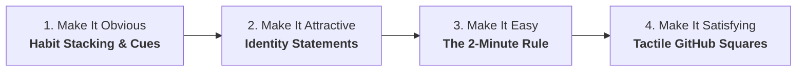

# Tessera — Atomic Habits & Atoms Methodology Architecture

This specification details how the principles of **James Clear's *Atomic Habits*** and the official **Atoms** app are systematically integrated into Tessera's user interface and habit mechanics.

---

## 1. The Core Atomic Philosophy

Traditional habit trackers focus on **outcome metrics** (e.g., "Hit 100 check-ins"). Atomic habit tracking focuses on **identity formation** and **reducing the activation energy** of showing up.

> *"Every action you take is a vote for the type of person you wish to become. No single instance will transform your beliefs, but as the votes build up, so does the evidence of your new identity."* — James Clear

---

## 2. The 4 Laws of Behavior Change in Tessera

### Law 1: Make It Obvious (Habit Stacking & Implementation Intentions)
- **The Formula**: `"After [CURRENT HABIT], I will [NEW HABIT] in [LOCATION]."`
- **In Tessera**:
  - The Habit Creator provides a dedicated **Habit Stacking Cue** field with smart prompts (e.g., *"After morning coffee..."*, *"When I close my laptop..."*, *"Before evening shower..."*).
  - The Home Screen Widget and Habit Card display this cue beneath the title so the environmental trigger is always visible at a glance.

### Law 2: Make It Attractive (Identity-Based Habits)
- **The Shift**: Move from *"I want to sing/code/write"* (outcome) to *"I am a vocalist / craftsperson / author"* (identity).
- **In Tessera**:
  - Each habit has an **Identity Statement** (e.g., *"I am a disciplined vocalist who practices riyaaz daily"*).
  - Check-in buttons provide celebratory feedback: *"1 vote cast for your vocalist identity."*

### Law 3: Make It Easy (The 2-Minute Rule)
- **The Rule**: Scale down the habit until it takes less than 2 minutes to perform (e.g., *"Sing 2 vocal scales"*, *"Write 1 sentence"*, *"Put on running shoes"*).
- **In Tessera**:
  - The Habit Creator includes a **2-Minute Micro Version** field.
  - On low-energy days or when inspecting an uncompleted habit, the user can check off the 2-Minute Starter version to keep the streak alive without burnout.

### Law 4: Make It Satisfying (Immediate Visual & Tactile Proof)
- **The Reward**: The human brain prioritizes immediate rewards over delayed benefits.
- **In Tessera**:
  - Tapping the circular check button provides immediate, tactile spring haptic feedback and lights up today's square on the GitHub-style contribution mosaic.
  - The mosaic turns abstract effort into a tactile tapestry of historical proof.

---

## 3. The "Never Miss Twice" Rule (Streak Resilience)

A major flaw in rigid habit trackers (like HabitKit) is that missing one day resets a 30-day streak to `0`, causing user discouragement and abandonment.

James Clear's rule:
> *"Missing once is an accident. Missing twice is the start of a new habit."*

- **In Tessera**:
  - Yesterday's check-in has a **Grace Shield**: If you miss today, yesterday's streak is preserved.
  - The app displays an encouraging banner: *"Never miss twice. Cast your vote today to keep momentum alive."*
