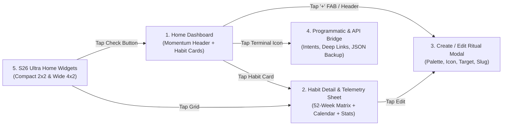

# Tessera — Product UX & Minimalist Visual Design System
**Target Device Profile:** Samsung Galaxy S26 Ultra (6.9" QHD+ Dynamic AMOLED 2X, 3120×1440, 120Hz LTPO, One UI 8 / Android 16)

---

## 1. Design Philosophy & How Tessera Differs from HabitKit

**Tessera** (from the Latin *tessera*—individual mosaic tiles that form a unified architectural pattern) takes the beloved tactile satisfaction of GitHub contribution heatmaps and reimagines it through the lens of **Swiss Neo-Brutalist Typography, Linear's specular dark surfaces, and Teenage Engineering / Nothing OS precision instrumentation**.

### Visual & UX Differentiation Matrix (HabitKit vs. Tessera)

| Dimension | HabitKit (Reference) | Tessera (Our Architectural Vision) |
| :--- | :--- | :--- |
| **Overall Aesthetic** | Playful, dense, rounded boxy cards with high-saturation neon fills. | **Architectural Precision**: Ultra-clean editorial hierarchy, hairline `1dp` specular borders, subtle luminance layering, and tabular monospace metrics. |
| **Top-Level Context** | Simple app bar with settings & add icons; jumps straight into cards. | **Today's Rituals Momentum Header**: Editorial date header (`THU · OCT 16`), live daily completion progress bar (`5 / 7 RITUALS · 71%`), and horizontal category filter pills. |
| **Card Architecture** | Uniform rounded rectangles with icon + title on left, check button on right, grid below. | **Dual-Zone Specular Cards**: Top metadata bar with micro-badge for streak (`14D STREAK` in monospace pill), quantitative progress ring/counter (`2/3`), and tactile kinetic check trigger; bottom precision-aligned contribution matrix with optional month/weekday micro-axis labels. |
| **Typography** | Standard system sans-serif throughout. | **Tri-Font Typographic System**: High-contrast editorial display headers, crisp geometric UI sans (`Inter` / `Plus Jakarta Sans`), and **Tabular Monospace** (`JetBrains Mono` / `FontFamily.Monospace`) for all streaks, dates, percentages, and programmatic slugs. |
| **Multi-Intensity Shading** | Primarily binary (on/off) or basic opacity. | **True 5-Stop Chromatic Heatmaps**: Level 0 (empty recessed tile) through Levels 1–4 calibrated per palette for both Quantitative habits (`1/4` to `4/4` daily target) and streak intensity. |
| **Programmatic First** | Manual tracking only. | **First-Class Automation Identity**: Every habit displays its unique monospace `slug` (e.g., `#deep-work`) and supports instant local Intent/Deep-Link triggers and payload inspection. |

---

## 2. Exact Color Tokens

### 2.1 True AMOLED Obsidian Dark Theme (Default for S26 Ultra)
Engineered specifically for the S26 Ultra's Dynamic AMOLED 2X panel to eliminate haloing, minimize battery draw, and create subtle depth via `1dp` top-edge specular borders rather than muddy drop shadows.

| Token Name | Hex Value | Usage |
| :--- | :--- | :--- |
| ` SurfaceAbyss` | `#07080B` | Primary screen canvas (near-true OLED black with a cool carbon undertone) |
| `SurfaceCard` | `#101217` | Primary habit card surface & widget background |
| `SurfaceElevated` | `#161920` | Interactive surfaces, bottom sheets, segmented controls, uncompleted today button |
| `SurfaceRecessed` | `#181B22` | Level 0 (Empty) heatmap square inside a Dark Card |
| `BorderHairline` | `#1F242D` | `1dp` card border, divider lines, inactive chip stroke |
| `BorderSpecular` | `#2C3340` | Highlighted card border (e.g., 100% completed habit or active focus) |
| `TextPrimary` | `#F3F4F6` | Primary titles, active numerals, editorial headers |
| `TextSecondary` | `#8A919E` | Subtitle descriptions, category labels, axis markers |
| `TextMuted` | `#525866` | Disabled states, future dates, empty state hints |

### 2.2 Warm Alabaster Light Theme
Inspired by archival Swiss print design and warm gallery paper—never sterile `#FFFFFF` backgrounds.

| Token Name | Hex Value | Usage |
| :--- | :--- | :--- |
| `SurfaceAbyssLight` | `#F6F5F2` | Warm Alabaster primary screen background |
| `SurfaceCardLight` | `#FFFFFF` | Crisp gallery white habit card surface |
| `SurfaceElevatedLight` | `#EAE8E1` | Interactive pill surface, secondary buttons, filter chips |
| `SurfaceRecessedLight` | `#EDEBE4` | Level 0 (Empty) heatmap square inside a Light Card |
| `BorderHairlineLight` | `#E2DFD7` | `1dp` architectural border around cards and widgets |
| `TextPrimaryLight` | `#111317` | Deep ink black for primary typography |
| `TextSecondaryLight` | `#686D76` | Warm slate for subtitles and metadata |
| `TextMutedLight` | `#9CA3AF` | Muted stone for disabled/empty markers |

### 2.3 Eight Curated Architectural Accent Palettes (5-Stop Heatmap System)
Each habit is assigned one of 8 palettes. Every palette defines **5 discrete intensity stops**:
- **Level 0**: Uses `SurfaceRecessed` (`#181B22` Dark / `#EDEBE4` Light)
- **Level 1 (25% / Light activity)**: Subtle deep tint
- **Level 2 (50% / Moderate activity)**: Mid-tone saturation
- **Level 3 (75% / Strong activity)**: High saturation
- **Level 4 (100%+ / Target met or Binary Complete)**: Full luminous accent

| Palette ID & Name | Level 1 (25%) | Level 2 (50%) | Level 3 (75%) | Level 4 (100% / Primary Accent) | On-Accent Text |
| :--- | :--- | :--- | :--- | :--- | :--- |
| `EMERALD_MATRIX` (Classic GitHub Reimagined) | `#0E3A2A` | `#166544` | `#229965` | `#34D399` | `#052E1E` |
| `CYBER_AMBER` (Teenage Eng. Warm Signal) | `#45230B` | `#7C3AED00` -> `#85420E` | `#C26116` | `#F59E0B` | `#271202` |
| `COBALT_PULSE` (Linear Electric Blue) | `#152956` | `#1E40AF` | `#3B66F5` | `#60A5FA` | `#08142C` |
| `CRIMSON_EMBER` (Nothing OS Signal Red) | `#47141A` | `#821D29` | `#BE293B` | `#F43F5E` | `#28070B` |
| `VIOLET_NEBULA` (Deep Synth Purple) | `#2B184E` | `#4C2889` | `#7442C8` | `#A78BFA` | `#170B2E` |
| `CYAN_GLACIER` (Cryo Telemetry) | `#0C3644` | `#145E75` | `#0891B2` | `#22D3EE` | `#04222C` |
| `ROSE_QUARTZ` (Editorial Coral Pink) | `#461533` | `#7D2259` | `#B83280` | `#F472B6` | `#29081D` |
| `MONOCHROME_INK` (Swiss High-Contrast) | `#272B33` | `#4B5262` | `#8A92A6` | `#F3F4F6` (Dark) / `#111317` (Light) | `#07080B` / `#FFFFFF` |

---

## 3. Typography, Spacing & Grid Geometry

### 3.1 Typographic Scale
- **Display Momentum Header**: `28sp`, SemiBold (`600`), `-0.8sp` letter spacing.
- **Section / Modal Title**: `20sp`, SemiBold (`600`), `-0.4sp` letter spacing.
- **Habit Card Title**: `16sp`, SemiBold (`600`), `-0.2sp` letter spacing, single line with ellipsis.
- **Habit Card Subtitle / Description**: `12sp`, Regular (`400`), `TextSecondary`.
- **Telemetry / Monospace Badge (`FontFamily.Monospace`)**: `11sp`, Medium (`500`), `+0.6sp` tracking, uppercase (`18D STREAK`, `86%`, `#deep-work`).
- **Micro Axis Labels (Month / M-W-F)**: `9sp`, `FontFamily.Monospace`, `TextMuted`.

### 3.2 GitHub Contribution Square Geometry
- **Full Card Heatmap (Home Screen - Standard View)**:
  - **Rows**: `7` (Monday through Sunday, vertically aligned).
  - **Columns**: Dynamically calculated via `BoxWithConstraints` to fill 100% of the card's inner width (`~20 to 26 weeks` visible at once on the S26 Ultra's `412dp`–`448dp` viewport width, horizontally scrollable to inspect all 52 weeks, defaulting scrolled to the current week on the far right).
  - **Cell Size**: `11dp × 11dp`
  - **Cell Corner Radius**: `2.5dp` (sharp architectural tile—not circles, not overly rounded pills)
  - **Cell Gap**: `3dp` horizontal and vertical spacing
  - **Today's Cell Indicator**: If uncompleted today, renders with a subtle `1dp` inner border in the habit's Level 3 accent color so "Today" is immediately identifiable in the bottom-right column.
- **Compact Matrix Grid (Home Screen - 2-Column Bento Mode)**:
  - Displays 2 habit cards per row.
  - Shows the last `10 weeks × 7 days` (`9dp × 9dp` cells, `2.5dp` gap, `2dp` radius).

---

## 4. Screen-by-Screen Layout & Component Specification



### 4.1 Screen 1: Home Dashboard (`HomeScreen`)
1. **Top Editorial Bar & Momentum Header**:
   - **Left**: Monospace date overline (`THU · OCT 16 · WEEK 42`) in `TextSecondary`, followed by large title **`Tessera`**.
   - **Right Action Cluster**:
     - View Mode Toggle Icon (`Full Architectural Cards` vs. `2-Column Compact Bento Grid`).
     - Theme Mode Toggle (`Obsidian Dark` / `Alabaster Light`).
     - Developer API / Settings Button (`>_` terminal icon with active badge).
   - **Daily Momentum Bar (Card-less HUD Strip)**:
     - Shows today's completion fraction in tabular monospace: `TODAY'S MOMENTUM` on the left, `04 / 06 COMPLETED · 67%` on the right.
     - Below it: A `4dp` ultra-sleek segmented progress bar where each completed habit lights up a segment in its respective accent color.
2. **Category Filter & Quick-Sort Bar**:
   - Horizontally scrollable pill strip: `ALL (6)`, `MIND`, `BODY`, `CRAFT`, `HEALTH`, plus `ARCHIVED`.
   - Active pill uses `TextPrimary` background with inverted text; inactive pills use `SurfaceCard` with `BorderHairline` stroke.
3. **Habit Card List (`LazyColumn` with `12dp` spacing)**:
   - **Card Container**: `SurfaceCard` fill, `16dp` corner radius, `1dp` `BorderHairline` stroke, `14dp` internal padding.
   - **Card Header Row**:
     - **Icon Container**: `36dp × 36dp` squircle (`10dp` radius) tinted with `Level 1` background and `Level 4` vector icon (`18dp`).
     - **Title & Metadata Column**:
       - Row 1: Habit Name (`16sp` SemiBold) + optional monospace streak badge (`🔥 12D` or `12D` in a subtle `SurfaceElevated` pill).
       - Row 2: Subtitle or Target info (e.g., `Daily · 2 / 3 completed today` or `#morning-run`).
     - **Right Interactive Check-In Button**:
       - `40dp × 40dp` tactile squircle (`12dp` radius).
       - **Uncompleted State**: `SurfaceElevated` fill, `1dp` `BorderHairline` stroke, subtle `+` or checkmark icon in `TextSecondary`.
       - **Partial Quantitative State (e.g., `1/3` or `2/3`)**: Shows circular progress ring around the squircle and monospace fraction `2/3` in `Level 4` accent color.
       - **Completed State (`100%`)**: Solid `Level 4` accent fill, `On-Accent` crisp checkmark icon, and a spring scale bounce (`0.88f -> 1.06f -> 1.0f`) coupled with `HapticFeedbackType.LongPress`.
   - **Card Body (The GitHub Heatmap Matrix)**:
     - `10dp` top spacing below header.
     - Optional left-side micro weekday labels (`M`, `W`, `F`, `S` in `9sp` monospace) + horizontally scrollable 52-week `7-row` grid auto-scrolled to the current week on the right.

### 4.2 Screen 2: Habit Detail & Telemetry Bottom Sheet / Screen (`HabitDetailSheet`)
Triggered by tapping any habit card. Opens a full-height modal sheet (`SurfaceAbyss` / `SurfaceCard`) with:
1. **Top Header**:
   - Habit icon, title, category badge, and monospace programmatic slug chip (`tessera://log?slug=deep-work` — tap to copy).
   - Action icons: `Edit Habit`, `Archive`, `Delete`.
2. **4-Card Telemetry Bento Grid (2×2 Grid)**:
   - **Current Streak**: Large `26sp` `FontFamily.Monospace` numeral (`14 DAYS`), subtitle `Active sequence`.
   - **Best Streak**: `26sp` monospace (`42 DAYS`), subtitle `All-time record`.
   - **30-Day Consistency**: `26sp` monospace (`87%`), with a micro sparkline bar.
   - **Total Volume**: `26sp` monospace (`318`), subtitle `Lifetime completions`.
3. **Full 52-Week Contribution Explorer**:
   - Month headers (`JAN`, `FEB`, `MAR`...) aligned above columns.
   - Interactive cell inspection: tapping any square in the heatmap highlights it and updates a live **Selected Day Inspector Bar** directly below (`TUE, OCT 14 · 2/2 COMPLETED · "Focused 90m session"`).
4. **Interactive Monthly Calendar & Back-Fill Editor**:
   - Clean 7-column monthly calendar with `< PREV` / `NEXT >` month switcher.
   - Tapping any past or current date cycles the completion count (`0 -> 1 -> ... -> target -> 0`) so users can effortlessly back-fill missed check-ins.
   - Includes a **"Add Daily Field Note"** text input for the selected date (e.g., logging weight, pages read, or workout notes).
5. **Weekday Consistency Distribution**:
   - 7 vertical minimalist telemetry bars (`MON` through `SUN`) showing which days of the week the user is strongest or weakest.

### 4.3 Screen 3: Create / Edit Ritual Modal (`HabitEditorDialog`)
1. **Live Preview Card at Top**: Renders a real-time preview of the habit card as the user types the title, picks an icon, or changes the color palette.
2. **Identity Inputs**:
   - **Habit Title** (e.g., `Deep Work Session`)
   - **Programmatic Slug** (auto-generated in real time as `deep-work-session`, editable in monospace font for ADB/Tasker scripts)
   - **Description / Cue** (e.g., `90m uninterrupted blocks before noon`)
   - **Category Selector**: `MIND`, `BODY`, `CRAFT`, `HEALTH`, `FINANCE`, `SOCIAL`.
3. **Ritual Type & Quantitative Target**:
   - Segmented switcher:
     - **Binary (`1x / day`)**: Simple Done / Not Done.
     - **Quantitative (`N times / day`)**: Stepper for daily target (`2` to `20` units/day) + custom unit label (e.g., `pages`, `glasses`, `pomodoros`, `sets`). Heatmap squares automatically shade across Levels 1–4 proportional to `count / targetCount`.
4. **8-Palette Chromatic Swatch Picker**:
   - Shows all 8 palettes as interactive 5-square mini heatmaps so the user sees the exact multi-stop gradient before choosing.
5. **Curated Minimalist Vector Icon Grid**:
   - 24 crisp geometric icons (Terminal/Code, Book, Dumbbell, Water Drop, Meditation, Run, Sleep, Journal, Music, Bolt, Heart, Sun, Leaf, Coffee, Pill, Shield, Target, Timer, Flame, Compass, Brain, Pen, Bicycle, Sparkles).

### 4.4 Screen 4: Developer & Programmatic API Bridge (`ApiBridgeSheet`)
Designed for power users on the Galaxy S26 Ultra who automate their life with **Tasker, MacroDroid, Bixby Routines, Termux, or ADB**, and designed so a future external automation app can push habit data with zero refactoring:
1. **Architecture Status Banner**:
   - Shows active receivers: `TesseraAutomationReceiver (EXPORTED)` and `tessera://` URI Deep-Link Router.
2. **Interactive Live Trigger Sandbox**:
   - Select any existing habit slug from a dropdown, choose `+1 Increment`, `Set Exact Count`, or `Attach Note`, and tap **"Fire Live Broadcast Intent"** to test the programmatic pipeline right inside the app and see the heatmap update.
3. **Copyable Command Reference Cards (Monospace Code Blocks)**:
   - **Android Broadcast Intent (Tasker / ADB / External Companion App)**:
     ```bash
     adb shell am broadcast -a app.tessera.action.LOG_HABIT \
       --es slug "deep-work" \
       --ei delta 1 \
       --es date "2026-10-16" \
       --es note "Automated via Tasker" \
       -n app.tessera/.automation.TesseraAutomationReceiver
     ```
   - **URI Deep Link (Shortcuts / QR / Browser / NFC Tag)**:
     ```text
     tessera://log?slug=deep-work&delta=1&note=NFC_Desk_Tag
     ```
4. **JSON Vault Import / Export & Demo Seed**:
   - **Export Full JSON Snapshot**: Copies or shares the complete structured JSON of all habits + logs.
   - **Import JSON Payload**: Paste or load a JSON payload to batch-import habits and historical square logs.
   - **Reset / Reseed Realistic 6-Month Portfolio**: Restores rich sample data for demonstration.

---

## 5. Samsung Galaxy S26 Ultra Home Screen Widget Specification

Tessera provides native **Jetpack Glance / RemoteViews AppWidgets** styled specifically for One UI 8 on the Galaxy S26 Ultra home screen:

```
+-------------------------------------------------------+
|  [Icon] Deep Work                   18D STREAK   [✓]  |
|  #deep-work · 2/2 today                               |
|                                                       |
|  □ ■ ■ ■ □ ■ ■ ■ ■ ■ ■ □ ■ ■ ■ ■ ■ ■ ■ ■              |
|  ■ ■ □ ■ ■ ■ ■ ■ □ ■ ■ ■ ■ ■ ■ ■ ■ ■ ■ ■              |
|  ■ ■ ■ ■ ■ ■ □ ■ ■ ■ ■ ■ ■ ■ ■ ■ □ ■ ■ ■              |
|  ■ □ ■ ■ ■ ■ ■ ■ ■ ■ □ ■ ■ ■ ■ ■ ■ ■ ■ ■              |
|  ■ ■ ■ ■ □ ■ ■ ■ ■ ■ ■ ■ ■ □ ■ ■ ■ ■ ■ ■              |
|  ■ ■ ■ ■ ■ ■ ■ □ ■ ■ ■ ■ ■ ■ ■ ■ ■ ■ ■ ■              |
|  □ ■ ■ ■ ■ ■ ■ ■ ■ ■ ■ ■ □ ■ ■ ■ ■ ■ ■ [▣] <- Today   |
+-------------------------------------------------------+
```

### 5.1 Widget Variant A: Wide Architectural Matrix Widget (`4×2` One UI Grid)
- **Visual Container**: `#101217` (`SurfaceCard`) rounded to match One UI's widget corner radius (`22dp`), bordered by a `1dp` `#1F242D` stroke.
- **Top Bar**:
  - Left: Habit tinted icon + Habit Title (`14sp` Bold) + Monospace streak pill (`18D`).
  - Right: Direct **1-Tap Check-In Button** (`36dp × 36dp`) that increments today's count directly from the S26 Ultra home screen without opening the app.
- **Bottom Matrix**:
  - Renders a crisp bitmap/canvas of the habit's last **18 weeks × 7 days** of GitHub squares (`100%` sharp pixel alignment on QHD+ AMOLED) using the habit's exact 5-stop color palette.
  - Tapping the body of the widget deep-links straight into that habit's Detail Sheet.

### 5.2 Widget Variant B: Compact Ritual Tile (`2×2` One UI Grid)
- **Visual Container**: Compact square card designed to sit alongside Samsung Clock/Weather widgets.
- **Header**: Habit Icon + Title + Monospace Streak (`18D`) + 1-Tap Check button.
- **Matrix**: Last **8 weeks × 7 days** mini contribution grid.
- **Configuration Activity**: When dropping the widget onto the S26 Ultra home screen (or tapping a unassigned widget), the user selects which habit the widget tracks.
