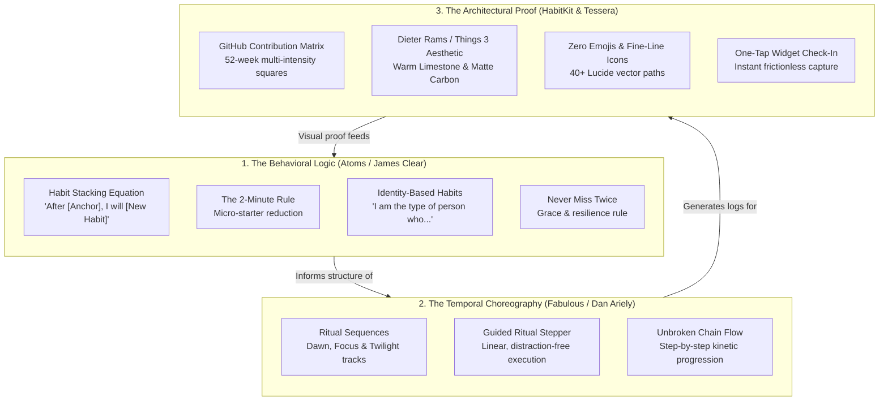

# Tessera Sync & Ritual Engine Specification
## Unifying Atoms (James Clear), HabitKit, and Fabulous into an Architectural Ritual Platform

---

## 1. Conceptual Synthesis: The Triad of Cohesive Action

A major risk when combining multiple productivity paradigms is creating a bloated, disjointed experience—such as slapping cartoon gamification from one app onto a minimalist data tracker from another. 

To prevent conceptual dissonance, Tessera establishes **The Triad of Cohesive Action**:



### The Three Pillars Defined:
1. **Behavioral Logic (Atoms)** answers **WHY and HOW** a habit forms:
   - Habits are never created in a vacuum. Every habit requires an **Anchor Habit** (`cue`), a **2-Minute Micro-Starter** (`response`), and an **Identity Statement** (`belief`).
2. **Temporal Choreography (Fabulous)** answers **WHEN and IN WHAT FLOW** habits are executed:
   - Instead of staring at an overwhelming to-do list, habits are woven into **Rituals** (Dawn Ritual, Deep Work Ritual, Twilight Ritual).
   - When launching a ritual, the UI transforms into a **Guided Ritual Stepper**—a calm, focused, step-by-step full-screen flow that leads the user from one habit to the next without cognitive fatigue.
3. **Architectural Proof (HabitKit & Tessera)** answers **WHAT PROGRESS LOOKS LIKE**:
   - The timeless beauty of the GitHub contribution heatmap matrix. Every step completed in a ritual instantly illuminates squares on the home screen widgets, web app, and mobile dashboard.

---

## 2. The Guided UI: The "Habit Stack Weaver"

Rather than asking users to read a static text guide, Tessera introduces an interactive visual builder: **The Habit Stack Weaver**.

### Visual Mechanics:
1. **The Chain Link Stepper**:
   - The user selects or inputs an **Anchor Habit** (e.g. `"Brew morning pour-over coffee"`).
   - An architectural kinetic connector line pulses down to the **New Habit** (`"Practice vocal warmups & singing"`).
   - The builder prompts for the **2-Minute Micro-Starter** (`"Sing 3 scales with piano app for 120 seconds"`).
   - The builder asks for the **Identity Anchor** (`"I am a disciplined vocalist"`).
2. **The Guided Ritual Mode ("The Chamber")**:
   - Tapping **"Begin Dawn Ritual"** enters a Zen-like kinetic session.
   - The screen dims into deep Matte Carbon or Warm Limestone.
   - Shows Habit 1 of 3: An elegant countdown micro-timer (e.g. 2 minutes) with the fine-line icon, instructions, and an audio/haptic pulse when complete.
   - Upon completion, a tactile check-in advances seamlessly to Habit 2 with a smooth vertical transition.
   - No cartoon confetti; instead, a quiet typographic message: *"Ritual complete. 3 tiles illuminated."*

---

## 3. Cloud Sync Architecture: Offline-First with Last-Write-Wins (LWW)

### Requirements:
- **100% Offline Resilience**: Mobile and web apps function fully without network connectivity.
- **Bi-Directional Sync**: Any check-in on phone or web is queued and synced automatically when back online.
- **Conflict Resolution**: Last-Write-Wins (LWW) based on `updatedAtEpochMs` timestamp per entity.
- **JWT Authentication**: Secure Bearer tokens (`accessToken` with 15m expiry, `refreshToken` with 30d expiry).

### Sync Schema & Payload:
```json
{
  "lastSyncTimestamp": 1760630000000,
  "habits": [
    {
      "id": "habit-uuid-or-slug",
      "slug": "vocal-riyaaz",
      "title": "Vocal Riyaaz & Singing",
      "description": "After brewing morning coffee, I will practice scales",
      "cueAnchor": "Brewing morning coffee",
      "microStarter": "Sing 3 scales for 2 minutes",
      "identityStatement": "I am a disciplined vocalist",
      "category": "CRAFT",
      "iconKey": "mic",
      "colorKey": "amber",
      "targetPerDay": 1,
      "ritualTimeOfDay": "DAWN",
      "sortOrder": 1,
      "isArchived": false,
      "updatedAt": 1760630120000
    }
  ],
  "logs": [
    {
      "id": "log-uuid-or-composite",
      "habitSlug": "vocal-riyaaz",
      "dateEpochDay": 20743,
      "count": 1,
      "note": "Focused on pitch accuracy in upper register",
      "updatedAt": 1760630125000
    }
  ]
}
```

### Endpoints:
- `POST /api/auth/register`: Create user account, returns `{ token, user }`.
- `POST /api/auth/login`: Authenticate user, returns `{ token, user }`.
- `GET /api/auth/me`: Get current authenticated user profile.
- `POST /api/sync`: Atomic bi-directional sync endpoint. Accepts client changes and returns server mutations since `lastSyncTimestamp`.
